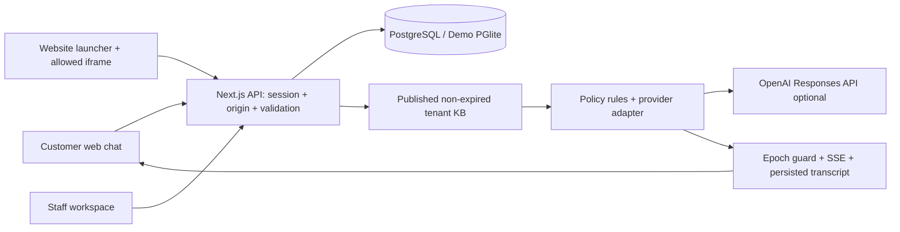

# RRS Connect — AI Chatbot + CRM
## Cloud Run / Cloudflare deployment

ดู [สถานะ deployment, secrets, การทดสอบ และข้อจำกัด cold start](docs/deployment-cloudrun.md) สำหรับ branch นี้ ระบบยังรอการเชื่อมต่อ Google Cloud ก่อนเผยแพร่จริง


เว็บแชตและพื้นที่ทำงานทีมขายสำหรับ RRS รุ่งเรืองดั๊มพ์ 101: ตอบข้อมูลที่อนุมัติ เก็บความต้องการลูกค้าไทย/ส่งออก และส่งต่อเจ้าหน้าที่เพื่อเสนอราคา มีฐานข้อมูล การเข้าสู่ระบบ และ API ที่ตรวจสิทธิ์จริง

**สถานะ: MVP สำหรับตรวจรับก่อนนำขึ้นระบบจริง ยังไม่ Deploy และยังไม่เชื่อม Sale Office, Google Sheets/Drive หรือ social channels** โหมด Demo ใช้ PostgreSQL แบบฝังตัวบนดิสก์และบอตจำลอง ไม่ได้เรียก AI ภายนอก ตัวเลข Dashboard คำนวณจากรายการในฐานข้อมูล รวมถึงรายการที่ผู้ทดลองสร้าง

ปรับปรุง **27 ตุลาคม 2026**: เปิดเข้ากล่องข้อความเป็นหน้าหลัก เพิ่มคิวงาน ข้อความยังไม่อ่านแยกตามพนักงาน การค้นประวัติและแบ่งหน้าฝั่งเซิร์ฟเวอร์ ข้อความตอบสำเร็จรูป และ Website Live Chat ที่ตั้งค่ารูปแบบกับเว็บไซต์ที่อนุญาตได้ ใช้ Noto Sans Thai Variable แบบ self-hosted เพื่อให้อ่านภาษาไทยได้สม่ำเสมอ งานนี้ยังเป็นการตรวจรับในเครื่อง **ไม่ได้ติดตั้งวิดเจ็ตหรือเปลี่ยนเว็บไซต์ธุรกิจ**

## เริ่มใช้งาน Demo

ต้องมี Node.js 22 ขึ้นไป (ทดสอบบน 24.19.0) และ pnpm 11.25.0

```sh
corepack enable
corepack prepare pnpm@11.25.0 --activate
pnpm install --frozen-lockfile
```

คัดลอก `.env.example` เป็น `.env.local` โดยคง `DEMO_MODE=true`, `AI_PROVIDER=demo`, `APP_ORIGIN=http://localhost:3000`

```sh
pnpm db:migrate
pnpm db:seed
pnpm dev
```

เปิด [พื้นที่ทีมงาน](http://localhost:3000) และ [แชตลูกค้า](http://localhost:3000/chat) ใช้ hostname ให้ตรง `APP_ORIGIN` หากเปิดผ่าน `127.0.0.1` แทน `localhost` ต้องปรับค่าด้วย ไม่เช่นนั้นระบบจะปฏิเสธคำขอแก้ข้อมูล

| บัญชี Demo | บทบาท |
| --- | --- |
| `admin@rrs.demo` | Admin องค์กร RRS |
| `agent@rrs.demo` | Agent องค์กร RRS |
| `outsider@other.demo` | Admin องค์กร B สำหรับทดสอบการแยกข้อมูล |

รหัสผ่าน Demo ทุกบัญชี: `Demo-only-2026!` เป็นข้อมูลตัวอย่างสาธารณะเท่านั้น การ seed จะถูกปฏิเสธเมื่อปิด Demo ไม่มีข้อมูลลูกค้าจริงใน seed

Demo เก็บข้อมูลใน `PGLITE_DIR` (ค่าเริ่มต้น `.data/rrs-demo`) หลัง refresh และ restart ข้อมูลยังอยู่ ใช้ได้เพียง **หนึ่ง process ต่อ directory** หยุดเซิร์ฟเวอร์ก่อนรันคำสั่งฐานข้อมูล ห้ามวาง PGlite บน serverless filesystem หรือใช้เป็นฐานข้อมูลหลาย replica

## ฟีเจอร์ที่ทำงาน

- แชตมือถือ/เดสก์ท็อป: SSE streaming, loading, retry ด้วย message ID เดิม, ประวัติผูก visitor cookie แบบ HttpOnly, ปุ่มส่งต่อคน, แบบฟอร์มยินยอมเก็บช่องทางติดต่อ
- ภาษาไทย/อังกฤษ: แยกตลาดไทย/ส่งออก เก็บรุ่นรถ ปี cab จำนวนและประเทศ รองรับการแก้ข้อมูลเดิม ถามข้อมูลที่ยังขาดทีละเรื่อง กฎราคา/ส่วนลด/สต็อก/น้ำหนักบรรทุกไม่ใช้คำตอบคาดเดา
- Inbox: คิวทั้งหมด/ของฉัน/ยังไม่มอบหมาย/รอทีม/ยังไม่อ่าน/ปิดแล้ว ค้นชื่อ เบอร์ อีเมลและประวัติข้อความทั้งหมดฝั่งเซิร์ฟเวอร์ พร้อม cursor pagination กรองเจ้าของงานและแท็กได้ รายการแชต บทสนทนาและรายละเอียดลูกค้าอยู่ในพื้นที่เดียวกัน
- สถานะอ่าน: แยกตามสมาชิก อ่านถึงข้อความที่เปิดดูจริง ไม่ล้างข้อความใหม่ที่เข้าระหว่างเปิดแชต การส่ง message ID ซ้ำไม่เพิ่มจำนวนยังไม่อ่าน เคสที่ปิดแล้วจะกลับเข้าคิวรอทีมเมื่อมีข้อความใหม่ โดยไม่เปิด AI กลับเอง
- การตอบร่วมกับทีม: รับช่วง/คืนให้บอต ตอบลูกค้าหรือบันทึกภายในอย่างชัดเจน สรุปข้อมูลที่ลูกค้าแจ้งแยกเรื่องรอตรวจสอบ และตรวจแหล่งข้อมูลพร้อมรุ่นเอกสาร
- ข้อความสำเร็จรูป: Admin สร้าง/แก้/ลบข้อความและคำย่อร่วมกันในองค์กร พร้อมตรวจรุ่นเอกสารก่อนเขียนทับ Agent เลือกใส่ร่างแล้วแก้ไขได้ ต้องกดส่งเอง ไม่มีการส่งหาลูกค้าเพียงเพราะเปิดหรือเลือกเทมเพลต
- Website Live Chat: ปุ่มเปิดแชตบนเว็บไซต์ หน้าต่าง iframe, streaming, ประวัติ, ฝากข้อมูลติดต่อและส่งต่อเจ้าหน้าที่ ตั้งชื่อ คำต้อนรับ สี ตำแหน่ง และ allowed origins ได้ มีตัวอย่างรูปแบบแยกจากการทดลองแชตจริง
- CRM: โปรไฟล์ แท็ก ความสนใจ ผู้รับผิดชอบ Pipeline 5 สถานะ งานติดตาม และประวัติการเปลี่ยนแปลง
- นัดหมาย: ลูกค้าตรวจวันเวลาและรายละเอียดก่อนส่งคำขอ สถานะยังเป็น pending จนเจ้าหน้าที่ยืนยัน ไม่มีการตัดสินใจจองอัตโนมัติหรือเชื่อมปฏิทินภายนอก
- Knowledge Base: FAQ/ข้อความ draft/published รุ่นเอกสาร สถานะ ready/error แหล่งข้อมูล วันหมดอายุ แก้/ลบมีผลกับการค้นครั้งถัดไปทันที เก็บสำเนาหลักฐานเก่าในประวัติข้อความ
- Dashboard: ข้อมูลจริง ช่วงวันที่ Asia/Bangkok Pipeline งานครบกำหนด อัตราส่งต่อ เวลาตอบ AI/พนักงาน โทเคนและค่าใช้จ่ายเมื่อมีข้อมูล
- Admin/Agent: ตรวจสิทธิ์ฝั่งเซิร์ฟเวอร์ทุกคำขอ แยกองค์กรด้วย query scope และ composite foreign keys ไม่เชื่อ tenant ID ที่ browser ส่งมา

## ตั้งค่าและทดลอง Website Live Chat

1. เข้าระบบด้วย Admin แล้วเปิด **เว็บไซต์และช่องทาง → 1. ปรับรูปแบบ** ตั้งชื่อ คำต้อนรับ สีและมุมที่แสดงปุ่ม จากนั้นบันทึก
2. กด **ทดลองแชตจริงด้วยค่าที่บันทึก** เพื่อทดลอง iframe ภายในแอป ข้อความที่ส่งจะบันทึกและเข้ากล่องข้อความจริงในฐานข้อมูล Demo; ส่วน **ตัวอย่างรูปแบบ** ไม่ส่งข้อความ
3. เปิด **2. ติดตั้งบนเว็บไซต์** แล้วเพิ่ม origin ที่อนุญาตแบบตรงตัว เช่น `https://rungruengdump101.com` หนึ่งรายการต่อบรรทัด เพิ่ม `https://www.rungruengdump101.com` แยกหากใช้งานจริง ห้ามใส่ path หรือ wildcard; HTTP localhost ใช้ทดสอบได้ใน Demo
4. หลังบันทึก หน้าจอมีโค้ดให้คัดลอกก่อน `</body>` ของเว็บไซต์ ตัวอย่างเมื่อมีโดเมนระบบจริงแล้ว:

```html
<script src="https://crm.example.com/widget.js" defer></script>
```

`crm.example.com` เป็นตัวอย่าง ให้แทนด้วยโดเมน HTTPS ของ RRS Connect ที่ได้รับอนุมัติให้เปิดใช้จริง โค้ดที่คัดลอกจาก localhost ใช้ได้เฉพาะการทดสอบในเครื่อง ขั้นตอนนี้เป็นคำแนะนำติดตั้งเท่านั้น **ยังไม่ได้เผยแพร่ระบบหรือแก้ `rungruengdump101.com` ให้**

ตัว loader อ่านเฉพาะการตั้งค่าสาธารณะโดยไม่ส่ง credential; การตอบแชตทำงานใน iframe ที่เรียก API ของแอปต้นทางเดียวกัน การอนุญาตเว็บไซต์ให้ฝัง iframe ไม่ได้เปิด cross-origin mutation API ให้เว็บไซต์นั้น หน้า `/widget` มี `frame-ancestors` ตาม allowlist ส่วนหน้า CRM ปฏิเสธการถูกฝัง เมื่อปิดวิดเจ็ตจะปฏิเสธหน้า iframe/session/ข้อความของวิดเจ็ต แต่ `/chat` ปกติยังใช้ได้

วิดเจ็ตใช้ `rrs_widget_visitor` แบบ `HttpOnly; SameSite=None; Secure; Partitioned` แยกจาก `rrs_visitor` แบบ `SameSite=Lax` ของหน้าแชตเต็ม การตรวจ header และการทดลอง iframe ภายในแอป **ยังไม่ใช่ผลทดสอบข้ามเว็บไซต์จริง** ต้องตรวจบน HTTPS และเบราว์เซอร์เป้าหมาย โดยเฉพาะนโยบาย third-party/partitioned cookies หากเบราว์เซอร์ไม่รองรับให้ใช้ลิงก์เปิดหน้าแชตเต็ม

## เชื่อม PostgreSQL และ AI จริง

1. จัดเตรียม PostgreSQL ที่เข้าถึงได้จาก Node server และตั้ง `DATABASE_URL` เป็น connection string ของบัญชีแอป ใช้ TLS ของผู้ให้บริการ ไม่ปิด certificate verification
2. ตั้ง `DEMO_MODE=false`, `APP_ORIGIN=https://โดเมนของคุณ`, `SESSION_SECRET` เป็นค่าที่สุ่มอย่างปลอดภัยอย่างน้อย 32 ตัวอักษร และ `PUBLIC_ORG_SLUG=rrs` ห้ามใช้ฐานข้อมูล Demo เป็น production
3. รัน `pnpm db:migrate` ตั้ง `PROVISION_ADMIN_EMAIL`, `PROVISION_ADMIN_NAME`, `PROVISION_ADMIN_PASSWORD` (อย่างน้อย 16 ตัวอักษร) เป็น environment ชั่วคราว แล้วรัน `pnpm exec tsx scripts/db.ts provision` ลบค่า provisioning หลังสำเร็จ คำสั่งไม่เขียนทับองค์กรเดิม
4. เข้าสู่ระบบ เพิ่มสมาชิกและเผยแพร่ KB ที่เจ้าของอนุมัติเอง Seed สาธิตจะไม่ถูกนำเข้า production อัตโนมัติ
5. ตั้ง `AI_PROVIDER=openai`, `OPENAI_API_KEY` ที่เซิร์ฟเวอร์เท่านั้น และ `OPENAI_MODEL` ที่บัญชีของคุณเข้าถึงได้ ตัวอย่างเริ่มต้น `gpt-6-luna` เปลี่ยนผู้ให้บริการได้ใน `src/lib/bot.ts`
6. หากต้องการประมาณค่าใช้จ่าย ให้ตั้ง `AI_INPUT_USD_PER_MILLION` และ `AI_OUTPUT_USD_PER_MILLION` ตามราคาปัจจุบันของโมเดล/สัญญาของคุณ ระบบใช้ usage จาก provider; ไม่มีข้อมูลจะแสดง “ไม่มีข้อมูล” ไม่มีการแต่งจำนวนโทเคน
7. `pnpm build` แล้ว `pnpm start` หลังผ่านการตรวจรับและได้รับคำสั่ง Deploy ตั้ง reverse proxy รองรับ SSE ไม่ buffer และ timeout มากกว่า 120 วินาที

OpenAI adapter ใช้ Responses API ฝั่งเซิร์ฟเวอร์ `stream:true`, `store:false` แยกคำสั่งระบบออกจากเอกสารและข้อความผู้ใช้ `store:false` ไม่ใช่การรับรองว่า provider ไม่มีการเก็บ log ทุกประเภท ต้องตรวจเงื่อนไขบริการจริงก่อนใช้ข้อมูลส่วนบุคคล

`AI_DAILY_CALL_LIMIT` ค่าเริ่มต้น 500 จองสิทธิ์ตอบในฐานข้อมูลต่อองค์กรต่อวันไทย เมื่อครบจะส่งต่อคน อัตรานี้รวมคำตอบ Demo/กฎด้วยเพื่อให้ทดสอบได้ **เป็นเพดานจำนวนครั้ง ไม่ใช่เพดานเงินบาท** งบ 2,000 บาท/เดือนยังขึ้นกับโมเดล โทเคน hosting ฐานข้อมูลและค่าช่องทาง ตั้ง spend limit ฝั่ง provider และเลือกโครงสร้างพื้นฐานก่อนเปิดจริง ไม่มีการสมัครบริการเสียเงินในงานนี้

หากใช้ proxy ให้ตั้ง `TRUSTED_IP_HEADER` เฉพาะ header ที่ proxy ลบค่าจากผู้ใช้และเขียนใหม่เสมอ มิฉะนั้นคงว่าง (ใช้ rate bucket รวมสำหรับการสร้าง session/login ซึ่งอาจจำกัดผู้ใช้หลายคนร่วมกัน)

## ทดสอบ

```sh
pnpm typecheck
pnpm test
pnpm test:migrations
pnpm build
```

เมื่อเซิร์ฟเวอร์ Demo เปิดอยู่ที่ localhost:3000 ให้รันอีก terminal:

```sh
pnpm test:api
pnpm test:helpdesk
```

รันสองชุด HTTP ตามลำดับ ไม่รันพร้อมกันหรือแก้ข้อมูลผ่านหน้าเว็บระหว่างทดสอบ เพราะมีการเทียบจำนวนรายการก่อน/หลัง และชุด helpdesk จะเปลี่ยนการตั้งค่าวิดเจ็ตชั่วคราวแล้วคืนค่าเดิม ใช้ `BASE_URL` เพื่อเปลี่ยน URL เป้าหมาย ทั้งสองชุดสร้าง/แก้ข้อมูลตัวอย่างจริง **รันเฉพาะฐานข้อมูล Demo สำหรับทดสอบ** ถ้าทดสอบซ้ำจนชน rate limit ให้ใช้ directory Demo ใหม่หลังหยุด server ห้ามลบข้อมูลใช้งานจริงเพื่อรันทดสอบ

`test:migrations` สร้าง directory ทดสอบแยกภายใต้ `.data/` ไม่เปิดฐานข้อมูลของแอป ตรวจอัปเกรด schema เดิม การคงข้อมูลและ read watermark รวมถึง cursor ที่มีเวลาระดับ microsecond ผลตรวจรอบสุดท้ายวันที่ 27 ตุลาคม 2026: **ผ่าน 65 กรณี** ได้แก่ unit/provider/widget 29, migration 4, API เดิม 17 และ helpdesk/widget 15; TypeScript และ production build ผ่านเช่นกัน การทดสอบ browser และบริการภายนอกแยกรายงานในเอกสารตรวจรับ เอกสารนี้บันทึกผลตรวจในเครื่อง ส่วนสถานะ Remote CI ให้ดูจาก checks ของ Pull Request

ดูผลตรวจรับและข้อจำกัดที่ `docs/VERIFICATION.md` ไม่มีการกล่าวอ้างว่าทดสอบ OpenAI บัญชีจริงหรือ managed PostgreSQL หากยังไม่ได้ทำ

## แบบจำลองและความปลอดภัย



ตารางหลัก: `organizations`, `members`, `staff_sessions`, `visitors`, `leads`, `conversations`, `messages`, `conversation_reads`, `reply_templates`, `tasks`, `knowledge`, `audit_events`, `rate_buckets`, `ai_daily_usage` migration อยู่ใน `migrations/` และรันตามรุ่น `001` → `002` ทุก entity ของลูกค้าผูก `org_id`; foreign key คู่ `(org_id,id)` ป้องกันการอ้างข้ามองค์กร บัญชีใช้ salted scrypt และ cookie token เก็บเป็น HMAC hash ที่ฐานข้อมูล ไม่มี localStorage access token

Unread ใช้ลำดับข้อความลูกค้าที่เพิ่มครั้งเดียวต่อ message ID และ watermark ต่อสมาชิก ส่วน Inbox แบ่งหน้าด้วยเวลาที่รักษา microsecond พร้อม UUID เพื่อไม่ข้ามแถวที่อัปเดตใกล้กัน การตั้งค่าวิดเจ็ตและข้อความตอบสำเร็จรูปแยกองค์กรและเขียนได้เฉพาะ Admin

การรับช่วงเปลี่ยน status และ version ภายใน transaction การส่งแต่ละ chunk และการบันทึกคำตอบตรวจ version โดยล็อกแถวเดียวกับการ claim พนักงานจึงหยุด generation เก่าได้ ฝั่งลูกค้าตรวจ version/status เพิ่มอีกชั้น คำตอบที่ถูกขัดจังหวะไม่ถูกใช้เป็นประวัติหลักฐานให้ AI ต่อ

ความจำความต้องการเป็นข้อมูลที่ลูกค้าแจ้งเอง ไม่ใช่การอนุมัติสเปก ส่วนชื่อ/เบอร์/อีเมลมีแบบฟอร์มขอความยินยอมและบันทึก consent version/time ไม่ถือเป็นความยินยอมทางการตลาด การพิมพ์ข้อมูลส่วนบุคคลในแชตยังทำให้ข้อมูลนั้นอยู่ใน transcript ต้องกำหนด privacy notice และระยะเก็บก่อนใช้จริง

Session เจ้าหน้าที่มีอายุ 12 ชั่วโมง; visitor 30 วัน รัน `pnpm exec tsx scripts/db.ts cleanup` เพื่อล้าง session/rate bucket ที่หมดอายุ ข้อมูลลูกค้าไม่ถูกลบอัตโนมัติใน MVP ให้กำหนด retention, กระบวนการส่งออก/ลบข้อมูลและสำรอง/กู้คืนตามนโยบายองค์กรก่อนรับข้อมูลจริง การใช้ application scope นี้ไม่ได้อ้างว่าเปิด PostgreSQL RLS แล้ว

## ขอบเขตที่ยังต้องทำก่อนขยาย

- เชื่อม Sale Office/Sheets/Drive ต้องยืนยัน API และผู้เป็นเจ้าของข้อมูล ใช้ฐานข้อมูลนี้เป็นแหล่งหลักแชต/สถานะ แล้วส่ง projection ผ่าน outbox ที่มี idempotency/retry; **ยังไม่ได้ implement sync** ไม่มีการเขียนระบบ Sale Office เดิม
- LINE OA/Facebook/WhatsApp ยังไม่เชื่อม ต้องเพิ่ม channel identity, webhook signature/replay checks และข้อกำหนดการส่งข้อความก่อนเปิด
- Demo Adapter รองรับ intent/คำแก้เฉพาะที่ทดสอบ ไม่ใช่ LLM จริง สรุป facts เป็นโค้ดแบบกำหนดผลลัพธ์ ไม่ได้อ้างว่าโมเดลวิเคราะห์ทุกข้อความ
- ไม่รวม upload/OCR, vector embeddings, MFA/SSO, email invitation/reset password, calendar conflict checking, ใบเสนอราคาอัตโนมัติ หรือการรวมลูกค้าข้ามอุปกรณ์โดยใช้เบอร์ที่ยังไม่ยืนยัน
- Dashboard cohort นับการเปิด chat session เป็นบทสนทนา/ลีดใหม่ ยังไม่ใช่ยอดผู้ให้ข้อมูลติดต่อที่ผ่านการคัดกรอง Pipeline เป็นสถานะปัจจุบันของ cohort; due tasks เป็นงานเปิดทั้งหมดที่ครบกำหนด ณ ตอนนี้; usage กรองตามเวลา message
- Inbox ใช้การค้นประวัติและ pagination ฝั่งเซิร์ฟเวอร์แล้ว จึงไม่จำกัดอยู่ที่ 1,000 บทสนทนาที่เคยโหลดในหน้าเดิม แต่รายการ CRM/งานยังจำกัดที่ 2,000 รายการและค้น/กรองเฉพาะข้อมูลที่โหลด ส่วน Dashboard คำนวณจากข้อมูลทั้งหมดในช่วงที่เลือก
- ยังต้องทดสอบ backup/restore, PostgreSQL แบบหลาย process, browser อื่น, widget ข้ามเว็บไซต์จริงบน HTTPS และ load test ตามจำนวนผู้ใช้พร้อมกันก่อนใช้จริง คำตอบสำเร็จรูปสูงสุด 200 รายการต่อองค์กร และ allowed origins สูงสุด 10 เว็บไซต์

## เอกสารทางการที่ตรวจสอบ

ตรวจวันที่ **25 ตุลาคม 2026** เวอร์ชันที่ติดตั้งยืนยันจาก npm registry และล็อกใน `pnpm-lock.yaml`

- [Next.js installation](https://nextjs.org/docs/app/getting-started/installation) — Next.js 16.4.3 / React 19.3.1, Node requirement
- [shadcn/ui Next.js](https://ui.shadcn.com/docs/installation/next) — component-source pattern, Radix Slot และ CVA; components อยู่ใน repository และปรับสไตล์เอง
- [Tailwind Next.js guide](https://tailwindcss.com/docs/installation/framework-guides/nextjs) — Tailwind/PostCSS 4.3.3
- [PGlite getting started](https://pglite.dev/docs/) — embedded PostgreSQL พร้อม disk persistence สำหรับ Demo
- [node-postgres](https://node-postgres.com/features/queries) — parameterized SQL สำหรับฐานข้อมูลจริง
- [OpenAI streaming](https://developers.openai.com/api/docs/guides/streaming-responses) — server-side streaming events; [data controls](https://developers.openai.com/api/docs/guides/your-data)

ไม่มีการรับรองราคาผู้ให้บริการหรือความสอดคล้องกฎหมายจากการติดตั้งโค้ดนี้เพียงอย่างเดียว

### แนวทางหน้าจอและ Live Chat — ตรวจ 27 ตุลาคม 2026

- [Zaapi ภาษาไทย](https://www.zaapi.com/th) และ [Helpdesk](https://www.zaapi.com/th/product/unified-inbox): ใช้อ้างอิงลำดับการทำงานแบบคิว → รายการแชต → บทสนทนา → ข้อมูลลูกค้า แล้วปรับชื่อ ปุ่มและกฎให้เข้ากับงานขาย RRS ไม่ได้เชื่อมบัญชีหรือใช้ระบบหลังบ้าน Zaapi
- [FAQ Zaapi EP8: วิธีเพิ่ม Live Chat บนเว็บไซต์](https://www.youtube.com/watch?v=zhsOe-NOdIQ), เผยแพร่ 12 กันยายน 2025: จุดอ้างอิงที่ตรวจผ่านหน้าวิดีโอคือ 0:58 การปรับรูปแบบ, 2:23 การติดตั้ง และ 2:39 ตัวอย่างวิดเจ็ต ไม่ได้นำคำอ้างราคา/แพ็กเกจมาใช้กับ RRS
- ฟอนต์ใช้ **Noto Sans Thai Variable** จาก `@fontsource-variable/noto-sans-thai@5.3.0` แบบ self-hosted ทั้ง workspace และ widget; ไฟล์ WOFF2 ภาษาไทย/Latin และ [SIL Open Font License 1.1](public/fonts/OFL-Noto-Sans-Thai.txt) อยู่ในโครงการ ไม่โหลดฟอนต์จาก third-party CDN ระหว่างใช้งาน
